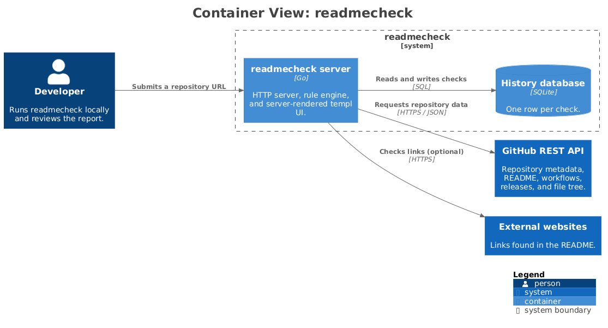

# readmecheck

readmecheck is a local-first Go web application that audits GitHub READMEs against 23 deterministic rules. Paste a repository URL and it retrieves the README and repository metadata, runs a weighted checklist, and returns a scored report with evidence, explanations, and concrete fixes. It does not use an LLM, so the same repository always produces the same result.

[](https://go.dev)
[](LICENSE)
[](#tests)

## Table of Contents

- [Why readmecheck](#why-readmecheck)
- [Features](#features)
- [Prerequisites](#prerequisites)
- [Installation](#installation)
- [Usage](#usage)
- [Configuration](#configuration)
- [Rules and scoring](#rules-and-scoring)
- [Architecture](#architecture)
- [Development](#development)
- [Tests](#tests)
- [Contributing](#contributing)
- [License](#license)

## Why readmecheck

A README is often the first and only page someone reads before deciding whether to install a project. Missing setup steps, stale links, absent license information, and unexplained screenshots are common problems that are easy to overlook when you already know the codebase.

readmecheck turns those expectations into a documented checklist. Every rule has a stable identifier, a category, a severity, a weight, and a rationale. Results show exactly what passed, failed, or was skipped, and failed checks include the evidence that triggered them. The final report is useful both as a review tool and as a way to compare improvements over time.

## Features

- 23 rules across basics, getting started, visuals, trust, contribution, hygiene, and link categories.
- English and German heading detection for installation, usage, requirements, contribution, and license sections.
- Weighted overall score from 0 to 100 with an A–F grade and per-category scores.
- Deterministic Markdown parsing through goldmark with GFM support.
- Optional external link checking with bounded concurrency and request timeouts.
- Relative link and image verification against the repository's real file tree, resolved from the README's directory.
- SQLite history with a latest-check-per-repository view and score deltas between runs.
- Bounded in-memory caching with conditional (`ETag`) GitHub requests, private-address blocking in the link checker, and no telemetry.
- Server-rendered templ UI with templUI components, htmx navigation, dark mode, and a responsive layout.
- Copy-to-clipboard and downloadable Markdown reports.
- No accounts, no telemetry, and no AI-generated judgments.

## Prerequisites

- Go 1.27.3 or newer.
- GNU Make.
- A network connection to reach the GitHub API.
- A GitHub token is optional, but raises the API rate limit from 60 to 5,000 requests per hour.

The Tailwind CSS standalone binary and the templ CLI are used by the build tasks. Install the pinned toolchain once with:

```bash
make tools
```

This installs templ and templUI into your Go bin directory and downloads the Tailwind standalone binary into the ignored `bin/` directory. The repository already includes generated templ files and compiled CSS, so the application itself does not require those tools at runtime.

## Installation

From a checkout of this repository, install the build tools and build the application:

```bash
make tools
make build
```

The build generates templ code, compiles the Tailwind stylesheet, and runs `go build ./...`. To install the binary into your Go bin directory instead:

```bash
go install ./cmd/readmecheck
```

## Usage

Start the server with:

```bash
make run
```

Then open [http://localhost:8080](http://localhost:8080) and paste a repository in any of these forms:

```text
owner/repo
github.com/owner/repo
https://github.com/owner/repo
https://github.com/owner/repo/tree/main
```

The server binds to `localhost:8080` by default. Set `PORT` to use a different port. External link checking is enabled by default in the form and can be switched off for a faster, network-free audit.

A report includes:

- The repository name, description, stars, license, latest release, and check time.
- The overall score, grade, passed/failed/skipped counts, and category progress bars.
- A checklist grouped by category with failed checks first.
- Evidence, a "Why it matters" explanation, and a "How to fix" suggestion for each failed or skipped check.
- A copy button and a downloadable Markdown file for sharing or tracking changes.

Direct report URLs are stable while the server is running: `/report/{owner}/{repo}`. Add `?external=1` to include external link checks. Each analysis is saved to the SQLite history database; reloading an unchanged report within five minutes reuses the previous row. The History page shows the latest result per repository with a re-run link.

## Configuration

All configuration is provided through environment variables:

| Variable | Default | Purpose |
| --- | --- | --- |
| `PORT` | `8080` | HTTP port on localhost. |
| `GITHUB_TOKEN` | empty | Optional token for higher GitHub API limits and private repositories. The token is never written to disk or displayed. |
| `GITHUB_API_URL` | `https://api.github.com` | Alternate GitHub-compatible API base URL, useful for testing. |
| `DATABASE_PATH` | `readmecheck.db` | SQLite database file for check history. |
| `ASSETS_DIR` | `assets` | Directory containing the compiled CSS and JavaScript. |
| `EXTERNAL_LINKS` | `true` | Default state of the external-link switch. |

Example:

```bash
GITHUB_TOKEN=github_pat_example PORT=8090 DATABASE_PATH=/tmp/readmecheck.db make run
```

## Rules and scoring

Every rule contributes its weight when it passes. Skipped rules are excluded from both the earned points and the total available points, so missing optional data does not silently lower a score. Category scores use the same logic within each category. The overall score is rounded to the nearest integer and mapped to a grade:

| Score | Grade |
| ---: | :---: |
| 90–100 | A |
| 80–89 | B |
| 70–79 | C |
| 60–69 | D |
| 0–59 | F |

The seven categories are Basics, Getting started, Visuals, Trust and maintenance, Contribution, Hygiene, and Links. Each rule has a permanent ID such as `readme-exists` or `relative-links`, which makes reports and history entries easy to compare.

The complete list of rules, weights, rationales, and sources is in [docs/criteria.md](docs/criteria.md). Design decisions, known limitations, and the planned AI extension point are documented in [NOTES.md](NOTES.md).

## Architecture

readmecheck deliberately uses the Go standard library for HTTP routing and handlers. The GitHub client fetches metadata, the README, the root listing, workflows, the latest release, and a recursive file tree concurrently. The Markdown package builds a small document model with goldmark, the rule engine scores the model, and the templ views render the result.



The diagram is generated from the [Structurizr model](docs/architecture/workspace.dsl). The [component diagram](docs/architecture/components.png) zooms into the Go server and shows how the packages collaborate; the [system context diagram](docs/architecture/system-context.png) shows the external boundaries. All views and regeneration notes are in [docs/architecture](docs/architecture/README.md).

The rule engine exposes a small `Analyzer` interface for future non-deterministic extensions. No implementation is included: readmecheck's built-in reports remain fully rule-based and reproducible.

## Development

Useful Make targets:

```bash
make tools      # install templ, templUI, and the Tailwind standalone binary
make generate   # regenerate templ files
make css        # rebuild assets/css/output.css
make build      # generate, compile CSS, and build all packages
make test       # regenerate templ files and run all tests
make vet        # run go vet
make run        # build and start on localhost:8080
```

Project layout:

| Path | Responsibility |
| --- | --- |
| `cmd/readmecheck` | Process startup, environment configuration, and graceful shutdown. |
| `internal/github` | Repository URL parsing, GitHub API client, typed errors, and per-repository cache. |
| `internal/markdown` | GFM parsing and the README document model. |
| `internal/rules` | Rule definitions, link checking, weighted scoring, and Markdown export. |
| `internal/store` | SQLite migration and check history. |
| `internal/web` | HTTP handlers, routes, and templ view models. |
| `components` | Locally installed templUI components. |
| `docs` | Rule criteria and longer-form documentation. |

## Tests

The test suite uses only `httptest` servers and fixture files. GitHub API tests inject an HTTP client, and handler tests inject a fake repository provider, history store, and link checker, so the normal test run never contacts the real network.

```bash
go test ./...
go test -race ./...
go vet ./...
go build ./...
```

A final manual smoke test can use a public repository after the automated suite passes:

```bash
make run
# Open http://localhost:8080 and check charmbracelet/bubbletea
```

## Contributing

Contributions are welcome. Read [CONTRIBUTING.md](CONTRIBUTING.md) for the development workflow, test expectations, and pull request checklist. Bug reports should include the repository being checked and the rule ID involved when possible.

## License

readmecheck is released under the [MIT License](LICENSE). Copyright 2026 the readmecheck contributors.
