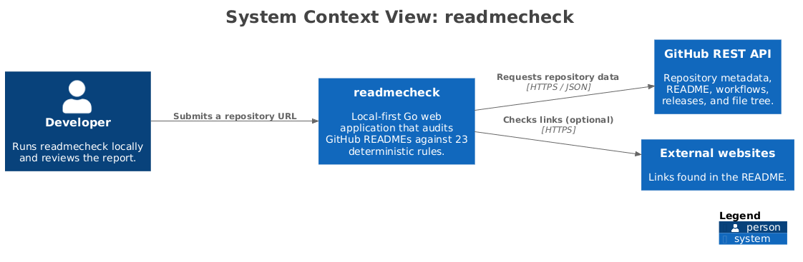
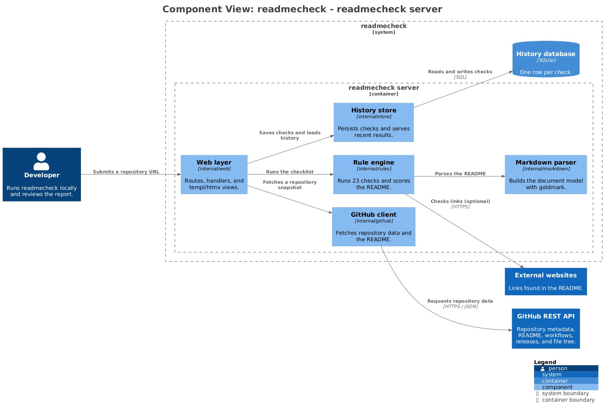

# Architecture

The architecture is modelled with [Structurizr](https://structurizr.com/) using the C4 model. The source of truth is [`workspace.dsl`](workspace.dsl); the PNG diagrams in this directory are generated from it.

The README embeds the container view. This directory also contains the system context and component views, plus the commands to regenerate all three.

## System context



## Containers


## Components



## Regenerating the diagrams

You need Java 17 or newer, the [Structurizr CLI](https://github.com/structurizr/cli/releases), [PlantUML](https://plantuml.com/download), and Graphviz. The diagrams were generated with Structurizr CLI 2025.11.09 and PlantUML 1.2026.9.

With both tools available, run:

```bash
STRUCTURIZR_CLI=/path/to/structurizr.sh \
PLANTUML_JAR=/path/to/plantuml.jar \
./docs/architecture/export.sh
```

The script exports the views to PlantUML, renders them to PNG, and replaces the images in this directory. The equivalent manual commands are:

```bash
structurizr export \
  -workspace docs/architecture/workspace.dsl \
  -format plantuml/c4plantuml \
  -output /tmp/readmecheck-diagrams

java -jar plantuml.jar \
  -tpng \
  -o /tmp/readmecheck-diagrams \
  /tmp/readmecheck-diagrams/*.puml
```

The generated files are named `structurizr-SystemContext.png`, `structurizr-Containers.png`, and `structurizr-Components.png`. Copy them to `system-context.png`, `containers.png`, and `components.png` respectively.

## Editing the model

Update `workspace.dsl`, then regenerate the diagrams. Keep descriptions short so the generated diagrams stay readable. The component view is the detailed view; the container view intentionally stays at the deployment-boundary level.
