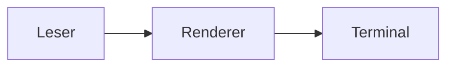

# Werkzeug

Werkzeug verwandelt einfache Textdateien in übersichtliche Diagramme für das Terminal. Es ist für schnelle Architekturskizzen und Dokumentation gedacht.

[](https://github.com/owner/demo/actions)

## Voraussetzungen

Benötigt Go 1.24 oder neuer.

## Einrichtung

Installiere das Werkzeug mit Go:

```bash
go install github.com/owner/demo@latest
```

## Verwendung

Übergib eine Quelldatei:

```bash
demo diagramm.txt
```

Das Ergebnis wird auf der Standardausgabe ausgegeben. Weitere Beispiele stehen im [Leitfaden](docs/leitfaden.md).


## Architektur



## Mitwirken

Fehlerberichte und Pull Requests sind willkommen. Bitte lies [CONTRIBUTING.md](CONTRIBUTING.md), bevor du einen Pull Request öffnest.

## Lizenz

Veröffentlicht unter der [MIT-Lizenz](LICENSE).
