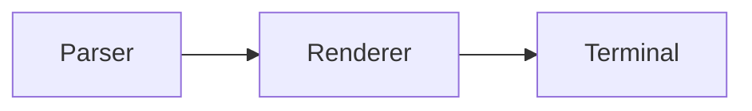

# Demo

Demo is a small command-line tool that turns structured text into colorful diagrams. It is designed for release notes, architecture sketches, and terminal-friendly documentation.

[](https://github.com/owner/demo/actions)

## Table of Contents

- [Features](#features)
- [Requirements](#requirements)
- [Installation](#installation)
- [Usage](#usage)
- [Configuration](#configuration)
- [Examples](#examples)
- [Architecture](#architecture)
- [Contributing](#contributing)
- [License](#license)

## Features

- Deterministic rendering
- Small binary with no runtime dependencies
- Works in pipes and interactive terminals


## Requirements

Demo requires Go 1.24 or newer. No database or network access is required.

## Installation

Install the latest release with the Go toolchain:

```bash
go install github.com/owner/demo@latest
```

On Windows, make sure the Go binary directory is on your `PATH`.

## Usage

Pass a source file to the command:

```bash
demo diagram.txt
```

The rendered diagram is written to standard output. Use `--output` to write a file instead. See the [guide](docs/guide.md) for the full command reference.

## Configuration

Configuration is read from `demo.yaml` in the current directory. The optional `theme` key accepts `light`, `dark`, or `auto`.

## Examples

Generate a diagram and open it in the browser:

```go
package main

import (
    "fmt"

    "github.com/owner/demo"
)

func main() {
    fmt.Println(demo.Render("A --> B"))
}
```

## Architecture



## Contributing

Bug reports and pull requests are welcome. Read [CONTRIBUTING.md](CONTRIBUTING.md) before opening a pull request, and run `go test ./...` first.

## License

Released under the [MIT License](LICENSE). Copyright 2026 the Demo authors.
